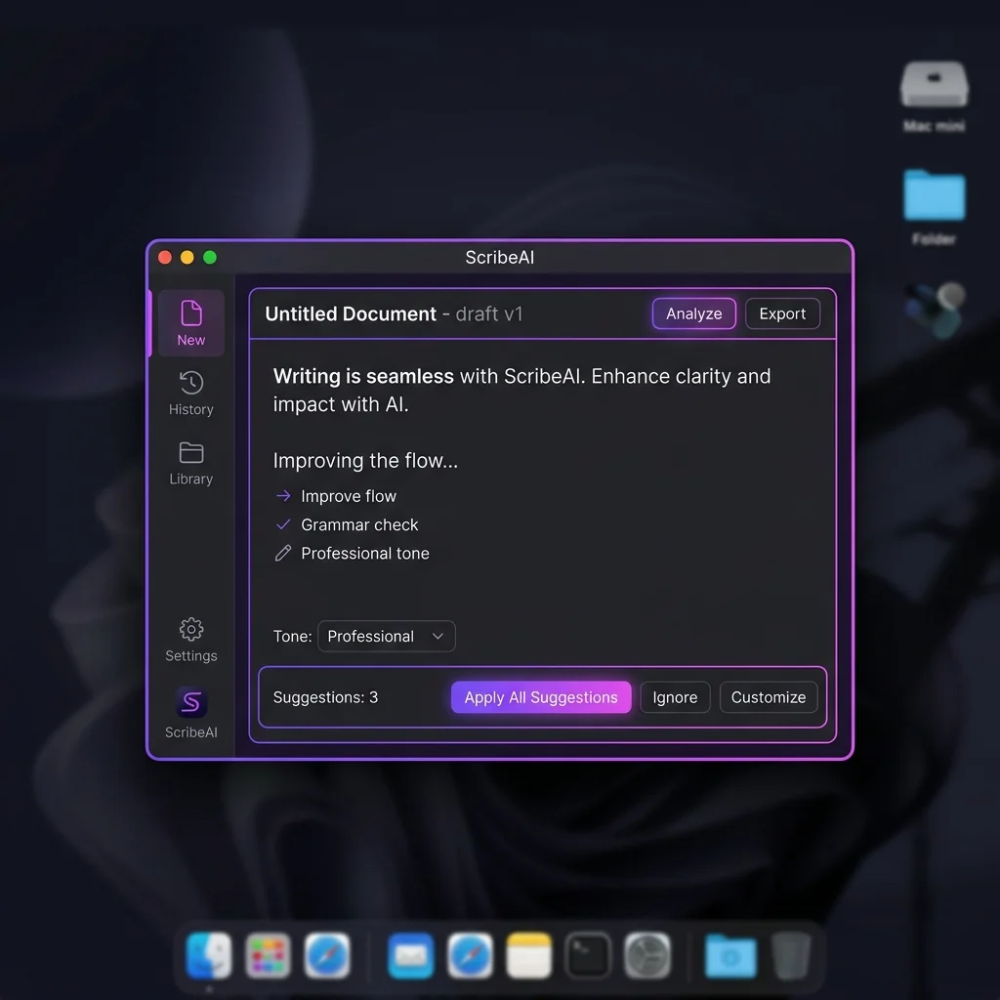

# ScribeAI — Free, Offline AI Writing Assistant for macOS


> Select text in any Mac app, press **⌥⌘S**, and ScribeAI rewrites it on your own
> machine — no server, no account, no upload. Free and open source under MIT.

<p align="center">
  
</p>

ScribeAI is a lightweight macOS app that rewrites, fixes grammar in, shortens, or expands
selected text in place. The default mode runs a quantized **Qwen2.5-1.5B-Instruct** model
entirely on your GPU through WebGPU, so nothing you write ever leaves the Mac. It works
system-wide in every native app — Notion, Slack, Notes, Mail, Word — from a single keystroke.

---

## Why it's different

| | ScribeAI | Cloud assistants |
|---|---|---|
| Where the model runs | **Your Mac (WebGPU)** | Their servers |
| Price | **Free, MIT open source** | Paid subscription |
| Text leaves your device | **No** | Yes, on every check |
| Works in any Mac app | **Yes, system-wide ⌥⌘S** | Usually browser plugins |
| Works offline | **Yes** | No |
| Account required | **No** | Usually |

---

## Features

- ✍️ **5 tone modes** — Professional, Casual, Improve, Concise, Expand
- 🎯 **Custom prompt** — add any extra instruction before rewriting
- ⚡ **Global shortcut** — works in every native macOS app (no browser tab needed)
- 🔒 **Privacy-first** — offline mode sends nothing anywhere; API mode goes only to the provider you pick
- 🧠 **Runs locally** — Qwen2.5-1.5B, 4-bit, ~1.6GB peak VRAM, one-time ~390MB download
- 🔄 **Auto-updater** — silent background updates via GitHub Releases
- 🌐 **Multiple AI providers** — offline WebGPU, built-in, or your own Gemini API key

---

## Installation

1. Download the latest `.dmg` from [Releases](https://github.com/Anirudh3434/scribeai/releases/latest)
2. Open the DMG and drag **ScribeAI** to your Applications folder
3. First launch: right-click the app → **Open** → confirm (Gatekeeper asks once)
4. Grant **Accessibility** permission when prompted (required for text replacement)

**Requirements:** Apple silicon (M1 or newer), macOS 12 or later, 8GB memory.

---

## How to Use

1. Select any text in any app (Notion, Slack, Notes, Gmail…)
2. Press **⌥⌘S** (or right-click → Services → ScribeAI)
3. Choose a tone, optionally add a custom instruction
4. Click **Improve Writing**
5. Click **Insert Text** — your selection is replaced instantly

---

## AI Providers

| Provider | Cost | Setup |
|----------|------|-------|
| **Offline (WebGPU)** | Free | Download ~390MB model once, then works with no network |
| **Built-in** | Free | None — works out of the box |
| **Your own Gemini key** | Pay-as-you-go | Paste your key in Settings |

The offline model is [Qwen2.5-1.5B-Instruct](https://huggingface.co/Qwen/Qwen2.5-1.5B-Instruct)
(Apache-2.0), quantized to 4-bit and served by [MLC WebLLM](https://github.com/mlc-ai/web-llm)
over [WebGPU](https://www.w3.org/TR/webgpu/).

---

## Development

```bash
# Install dependencies
cd desktop
npm install

# Run in development
npm start

# Build macOS DMG
npm run dist
```

### Environment Variables

Create `desktop/.env` for local development:
```
GH_TOKEN=your_github_token_for_auto_updater
```

> ⚠️ Never commit `.env` — it is gitignored.

### Deploy the API Proxy (Supabase Edge Function)

```bash
# Install Supabase CLI
brew install supabase/tap/supabase

# Link your project
supabase link --project-ref pqcqtpvmgziejnauidsu

# Set the Gemini API key as a secret (never in source code)
supabase secrets set GEMINI_API_KEY=your_gemini_key_here

# Deploy the proxy function
supabase functions deploy proxy-gemini --no-verify-jwt
```

---

## Project Structure

```
scribeai/
├── desktop/                 # Electron macOS app
│   ├── main.js              # Main process (IPC, auto-updater, API proxy calls)
│   ├── renderer.js          # UI logic + WebLLM offline inference
│   ├── preload.js           # Secure bridge
│   ├── setup-shortcut.js    # Auto-registers macOS Services shortcut
│   └── package.json
├── supabase/
│   └── functions/
│       └── proxy-gemini/    # Edge Function — holds API key server-side
├── docs/                    # Landing page (scribeai.shop, GitHub Pages)
├── voice_control/           # Experimental voice-control companion
├── manifest.json            # Chrome extension manifest (planned)
└── LICENSE
```

---

## Roadmap

- [ ] Chrome extension
- [ ] Windows app
- [ ] More tone presets and custom prompt library

Track progress or suggest features in [Issues](https://github.com/Anirudh3434/scribeai/issues).

---

## Contributing

Issues and pull requests are welcome. This is an independent, one-maintainer project —
bug reports with reproduction steps are especially helpful.

---

## License

MIT — see [LICENSE](LICENSE).

---

**Website:** [scribeai.shop](https://scribeai.shop/) · **Download:** [Latest release](https://github.com/Anirudh3434/scribeai/releases/latest) · **Support:** support@scribeai.shop
